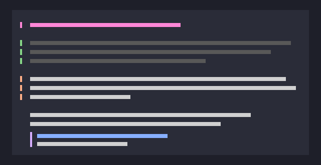
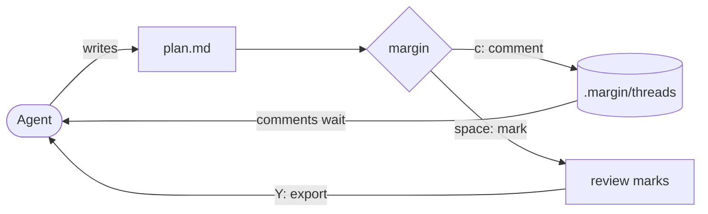
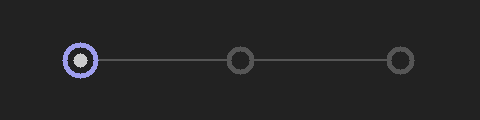
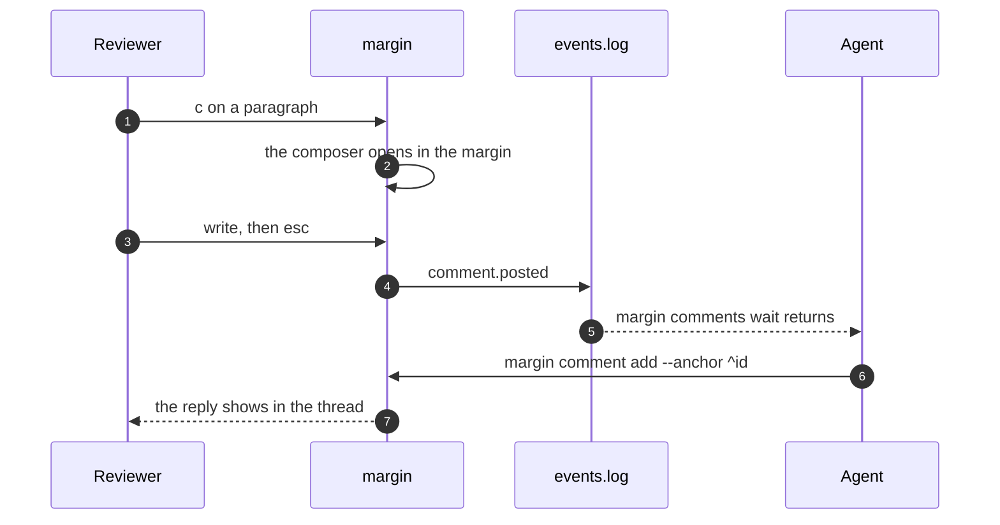
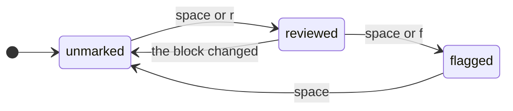
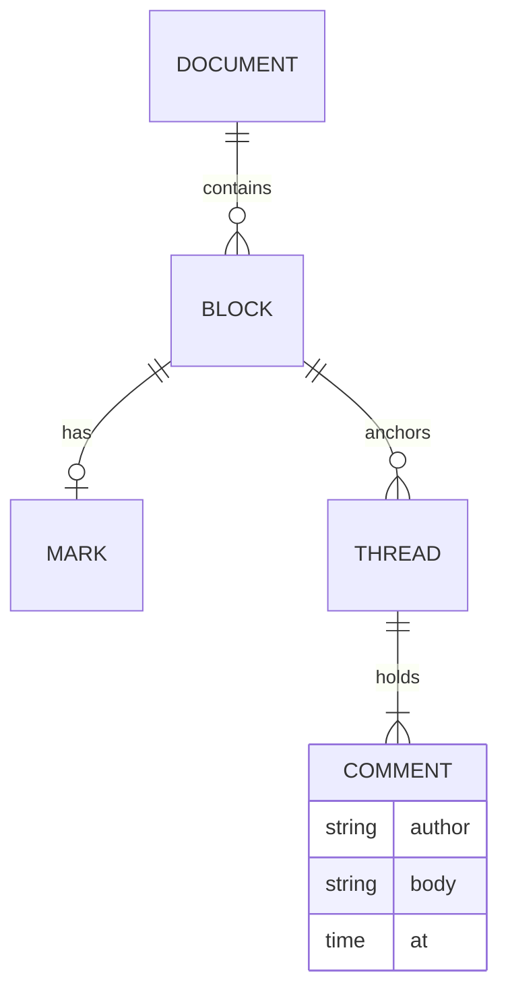

# A tour of margin

margin is a terminal tool for reviewing markdown. You read the **rendered**
document, leave comments anchored to *blocks*, mark what you have reviewed, and
hand the whole review back to whatever wrote the document. Press `j` and `k`
to move, `c` to comment, and `space` to mark a block. The [keys](#keys) are
listed below.



## The loop

An agent writes a plan, you review it in margin, and the agent reads your
comments back, either from the export or by waiting on the event log.





## What a comment does



## A block's review state



## What is stored

A review lives beside the document, in `.margin/`, and never inside it. Block
ids are the only thing margin writes into the markdown, and only when you ask.



### Threads

A thread is the conversation under one block. It has a few states, and each
changes what the reviewer sees:

1. **Open**: the default. It shows in the gutter and in the threads view.
2. **Resolved**: kept, but dimmed, and skipped by the next-comment hop.
   1. Resolve it with `x`; the agent sees `thread.resolved` in the log.
   2. Re-open it by replying.
3. **Orphaned**: its block is gone from the document. It is listed, never
   dropped, and marked `[block gone]`.

#### What survives a rewrite

Comments anchor to a block id, so they survive a *reworded* paragraph, a block
that *moved*, and a heading that was *renamed*. They do not survive a block
that was deleted, which is the one case the threads view reports instead.

---

## A longer paragraph, and what it does to the gutter

A paragraph this long wraps over several lines at the document's measure, and
the gutter marks every one of them, not only the first. Press `space` on it and
the whole block dims; press `c` and the thread attaches to the block, however
tall it is. Links such as [the keys](#keys), [the project](https://github.com/neuroplastio/margin)
and a `code span that is long enough to wrap if the line runs out` all sit
inside the same block, as does ~~struck text~~, **bold text**, *emphasis* and
***both at once***. A very long unbroken token,
`internal/review/surfhost_test.go:TestSurfHostRoutesTheEventsOfTwoSurfaces`,
checks that nothing is cut where it cannot wrap.

## Keys

| Key | Does |
| --- | --- |
| `j` / `k` | Move between blocks |
| `c` | Comment on the focused block |
| `space` | Cycle the mark: unmarked, reviewed, flagged |
| `/` | Search |
| `\` | Raw source |
| `i` | Every thread under review |
| `Y` | Copy the review |

## Try it

- Mark this list item reviewed with `r`.
- Flag this one with `f`.
  - Nested items are blocks too.
- [x] Open the demo
- [ ] Leave a comment on the diagram above

> A quote is a block like any other: comment on it, or mark it. Comments survive
> the block being reworded, because they anchor to an id, not a line.

The export is what the agent reads:

```go
// margin --stdout plan.md | agent -p "address this review"
type Review struct {
	Doc     string
	Threads []Thread
}
```

## Everything else a document has

### A table with alignment and markup

| Command | Where | Cost | Notes |
| :-- | :-: | --: | --- |
| `margin plan.md` | one file | 0 | opens the rendered file |
| `margin docs/` | a tree | 0 | the tree pane, with progress per file |
| `margin export plan.md` | stdout | `O(n)` | **everything** the agent reads |
| `margin comments wait` | event log | blocks | returns on the next *new* comment |
| `margin import-pr plan.md` | GitHub | a network call | imports review comments |

### Quotes that hold more

> **Review rule.** A block is reviewed when you say so, not when you scrolled
> past it.
>
> - A changed block loses its mark.
> - A moved block keeps it.
>
> > A nested quote is its own block, with its own comments.

### Code in other languages

```yaml
# .margin/config.yaml
review:
  root: docs/
  ignore: ["vendor/**", "*.generated.md"]
  reviewers: [toly, margin-agent]
```

```diff
 func (m *model) mark(i int) {
-	m.marks[i] = markOK
+	m.marks[i] = next(m.marks[i])
+	m.dirty = true
 }
```

```sh
margin --stdout plan.md | wc -l   # a very long line follows, to be scrolled across with h and l: ----------------------------------------------------------------------------------------------------
```

### A checklist with depth

- [x] Read the plan
  - [x] The overview
  - [ ] The rollback section
    - [ ] Whether the timeout is per call or per attempt
- [ ] Leave one comment per section
- [ ] Mark everything else reviewed

<details>
<summary>An HTML block, for the host to show as it is</summary>

Raw HTML is a block too; comment on it like any other.

</details>

Footnotes are not a thing in margin yet[^1], but a block that mentions one
still anchors.

[^1]: This is why a block's id is not its text.

### Links out of the document

A link to the web, [margin's README on GitHub](https://github.com/neuroplastio/margin#readme),
is a terminal hyperlink: click it. So is one to a file beside the document, like
[the demo's own screenshot](review.png) or [the Makefile two levels up](../../Makefile),
and one to a file from the review's root, like [the license](/LICENSE). A link to
[this section's heading](#links-out-of-the-document) is margin's own: `ctrl+]` follows it.
